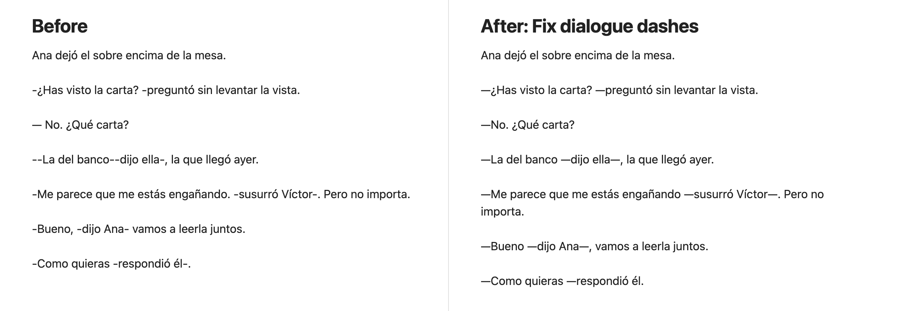
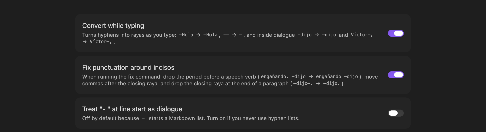

# Spanish Dialogue Dash

Obsidian plugin for Spanish dialogue dashes (raya, `—`), following
[correctores.es: guiones largos](https://www.correctores.es/guiones-largos/).

```
—Me parece que me estás engañando —susurró Víctor—, pero no importa.
—¡Qué buen día hace! —exclamó sonriente Jorge.
```



## While typing

- `-Hola` at line start → `—Hola` (`- ` with a space stays a Markdown list)
- `--` anywhere → `—`
- Inside a dialogue line: ` -dijo` → ` —dijo`, `Víctor-,` → `Víctor—,`

## Command: Fix dialogue dashes in note (or selection)

On every line that starts with `-`, `--`, `–` or `—`:

- Opening raya attached to the first word: `— Hola` → `—Hola`
- Inciso spacing: `engañando—dijo Víctor -, pero` → `engañando —dijo Víctor—, pero`
- Period before a speech verb removed: `engañando. —dijo` → `engañando —dijo`
- Comma moved after the closing raya: `Bueno, —dijo— vamos` → `Bueno —dijo—, vamos`
- No closing raya at paragraph end: `—dijo—.` → `—dijo.`

Hyphenated words (`ex-novio`), numbers (`3-4`, `-5`), links, code, frontmatter and code blocks are left alone.

Command **Insert raya (—)** inserts the dash; give it a hotkey in Settings → Hotkeys.

## Settings



## Develop

```bash
npm install
npm run build
npm test
npm run lint          # Obsidian's official lint rules (same as the plugin review)
npm run screenshots   # regenerate docs/images (macOS, needs Obsidian and Chrome)
```

## Install manually

Copy `main.js` and `manifest.json` to `<vault>/.obsidian/plugins/spanish-dialogue-dash/`,
then enable **Spanish Dialogue Dash** in Settings → Community plugins.

## Support

If this plugin helps you write, you can buy me a coffee:

<a href="https://buymeacoffee.com/coffeedrivendev"></a>

## License

[MIT](LICENSE) © Elisa De Gregorio
